# Open Kimi Web · 一键安装

复制对应系统的命令到终端运行，自动下载安装，无需手动下载脚本。

**Windows：打开 PowerShell，粘贴运行。**

```powershell
& {
  $api = 'https://api.github.com/repos/WilliamLambertCN/open-kimi-web/commits/v2.4.1-r1'
  $sha = (Invoke-RestMethod $api -ErrorAction Stop).sha
  if ($sha -notmatch '^[0-9a-fA-F]{40}$') { throw 'Invalid release commit SHA' }
  $url = "https://raw.githubusercontent.com/WilliamLambertCN/open-kimi-web/$sha/scripts/install.ps1"
  & ([scriptblock]::Create((Invoke-RestMethod $url -ErrorAction Stop))) --revision $sha --version 2.4.1-r1
}
```

**macOS / Linux：打开终端，粘贴运行。**

```sh
(
  set -eu
  api='https://api.github.com/repos/WilliamLambertCN/open-kimi-web/commits/v2.4.1-r1'
  metadata=$(curl --fail --silent --show-error --proto '=https' --tlsv1.2 "$api")
  sha=$(printf '%s\n' "$metadata" | sed -n 's/^[[:space:]]*"sha":[[:space:]]*"\([0-9a-fA-F]*\)".*/\1/p' | head -n 1)
  case "$sha" in ''|*[!0-9a-fA-F]*) exit 1 ;; esac
  [ "${#sha}" -eq 40 ] || exit 1
  url="https://raw.githubusercontent.com/WilliamLambertCN/open-kimi-web/$sha/scripts/install.sh"
  script=$(curl --fail --silent --show-error --proto '=https' --tlsv1.2 "$url") &&
    sh -c "$script" install.sh --revision "$sha" --version 2.4.1-r1
)
```

先检测并明确复用已有可用 Kimi，不下载或升级该官方 CLI；只有确认缺失才准备固定官方 `2.4.1`。
按需补齐 Node/npm 和 Windows Git Bash；损坏、歧义或不支持的候选明确拒绝，不当作缺失另装。
安装后新开终端运行 `kimi web --host`；运行时前提和其它选项见[快速上手](#快速上手)。

**把手机变成 Kimi Code 的第二块屏幕，也能看清模型用量与 API 等值费用。**
Open Kimi Web 保留官方 Web 与后端，在外层增加用量统计、局域网 HTTPS、移动页面适配和交互增强；
可通过命令接管让 `kimi web` 直接启动这些功能。

[![CI][ci-badge]][ci-workflow]
[](LICENSE)
[](packages/launcher/package.json)

> **这不是 Kimi Code 官方产品。** 独立的社区开源项目，与 Moonshot AI 无关联、不由其维护或背书。
> 默认界面直接来自官方 npm 包（MIT 许可）的构建产物；官方 logo 与样式版权归 Moonshot AI 所有。

> 版本目标：[v2.4.1-r1][current-release]，兼容目标 Kimi Code `2.4.1`；发布状态以正式 Release 为准。
> 本轮规范推理档位展示、说明原生 Tower 条件，并补齐已有 Kimi 发现与新版运行时检查，不强制开启实验功能。
> 保留 r2 用户要求的新模型默认和已有显式配置，不改变当前选择、官方默认推导或保存顺序。
> 本轮真实后端、双端界面、CI、包与线上记录见 [2.4.1 适配计划][compat241-plan]，未记录的检查不视为通过。
> [r2 计划][r2-plan]与 [r2 Release][r2-release]、[r1 适配][current-plan]和[热修复][provider-hotfix-plan]保留为历史证据。

## 本轮兼容：推理档位、Tower 与官方更新

**推理档位只改展示：** 已支持项按 `none → minimal → low → medium → high → xhigh → max` 排列，Max 最后；
未知项稳定保留在 Max 前，Auto／Off／On 保持所在入口的原语义。不增加支持项、不重排 `supportEfforts`，
不改当前值、默认值或保存数组，也不改变 r2 的新模型默认。旧 `low / medium / max` 经 Set 追加 `high / xhigh`，
会形成用户看到的乱序；旧测试只用已排序数组，未覆盖这种追加路径。根因与本轮验证边界见 [CHANGELOG](CHANGELOG.md)。

### Tower 为什么有时没有入口

Tower 是官方实验性多代理功能，不是账号或 provider 权限。Web 入口要求实际后端
`GET /api/v1/meta` 的 `experimental_flags.tower === true`，实验默认关闭。
单项 `KIMI_CODE_EXPERIMENTAL_TOWER` 优先于配置中的 Tower 设置，最后才回退全局实验开关；
应核对**正在运行的后端进程**继承的环境及 `KIMI_CODE_HOME`，不是只看当前终端或另一份配置。
会话 chip 还要求该会话已打开 Tower，且不是 Side Chat；没有 chip 不等于功能不存在，Side Chat 无入口是正常边界。

若确实希望启用，请先按[官方 Tower 指南][official-tower]检查仓库、权限及资源成本：worker／reviewer 使用 Never Ask，
可能快照未提交／未跟踪文件，各 agent 独立消耗 token／磁盘，worktree 不是安全沙箱。
接受这些实验边界后，**自行停止实际后端**，在同一重启终端设置单项环境变量，再启动已经接管的入口：

```powershell
$env:KIMI_CODE_EXPERIMENTAL_TOWER = 'true'
kimi web --host
```

```sh
KIMI_CODE_EXPERIMENTAL_TOWER=true kimi web --host
```

保留原本需要的 `KIMI_CODE_HOME`、工作区及启动选项；独立 `serve --target` 用户应重启 target 后端，不是只重启代理。
若后端启动时为 off，之后 live config 改成 true，入口可能已出现，但启动时未组装 Tower 工具；仅刷新页面不能补齐。
本项目不代改开关或自动重启。启用实验入口与在会话中打开 Tower 是两步；不以发模型请求来验证入口。

**从官方 2.3.1 到 2.4.1 的主要变化**（详见[官方更新日志][official-changelog]，均由上游实现）：

- `2.3.2` 默认不主动 delegate；AgentSwarm 须用户显式开启 swarm。
- `2.3.3` 增加 Swarm 高用量警示并更新模型切换确认；增强层保留原生确认、信任与会话锁，不自动接管。
- `2.4.0` 增加 Claude Code／Codex 近期会话导入（近 15／30 天）、provider refresh 和 `Ctrl-O` 思考显示切换。
  Tower 支持每任务模型，并发默认上限由 16 增至 256；Plan 由用户显式要求开启，并在执行前 review。
  会话空闲 30 分钟可卸载并透明恢复；审批／提问统一为 interaction，移除 node-pty 与 session terminal。
- `2.4.1` 的 Read 默认上限为 100,000 字符或约 25,000 tokens，先到为准，可用 `read.max_chars` 调整；
  同时精简内置 prompt 与重复提醒，并修复 Web 问题。这不是本项目新增的工具或上下文策略。

官方包、准确 commit 与 SRI 见 [UPSTREAM.md](UPSTREAM.md)；旧协议快照未为 `2.4.1` 重新捕获。
本轮不修改用户实际官方 CLI，不把历史验收当作新版通过，也不承诺实体手机或所有平台均已验证。

## 模型用量与 API 成本统计

**看清每个模型用了多少 token、命中了多少缓存，以及按 API 单价计算值多少钱。**
桌面从侧栏打开“使用统计”；手机先打开顶部的会话／工作区切换抽屉，再进入“使用统计”。
两端都可以查看同一台 Kimi 的历史用量。

- **时间与分布**：预设 `1d`、`3d`、`1w`、`1m`、`2m`、`3m`，对应最近 1、3、7、30、60、90 天，
  也可自定义起止时间；按模型和工作区筛选，查看用量趋势与模型分布。
- **四类 token 与缓存命中率**：普通输入、缓存读取、输出、缓存写入分别展示；
  命中率按所选范围内的缓存读取量除以总输入量计算，不平均各次请求的百分比。
- **API 等值费用**：随包提供数百项 OpenRouter 公共价格，联网合并 models.dev 与 OpenRouter；
  对真实模型 ID 给出自动候选，模糊建议不直接计费，审核后可批量确认，手动映射和单价优先。
  刷新目录时保留各模型原默认键，同键使用新单价，缺失键沿用上次有效价格并标为旧价；
  旧版缓存按已知内置来源自动恢复，无需删除缓存或迁移会话数据。
- **模型 ID 统计**：按实际请求的模型 ID 汇总和定价；同 ID 的不同别名合并，别名改绑后分开统计。
  大列表分批渲染并使用单一纵向滚动区；价格配置可搜索任意历史模型 ID 和公开目录项。
- **历史回补**：读取官方已保存的用量记录，覆盖同一数据目录的 CLI、Web 与 agent 调用，
  排除 fork 复制的历史前缀。用量留在本机，联网只下载公共价格目录。

使用统计总览与价格自动匹配，**点击缩略图查看原图**：

<table>
  <tr><th width="65%">桌面端</th><th width="35%">手机端</th></tr>
  <tr>
    <td align="center" valign="top">
      <a href="docs/images/feature-usage-desktop.png">
        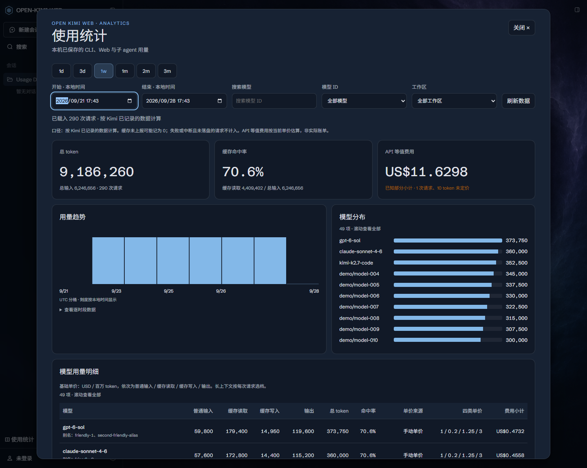
      </a>
    </td>
    <td align="center" valign="top">
      <a href="docs/images/feature-usage-mobile.png">
        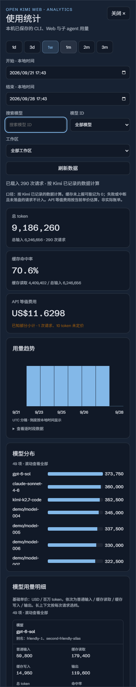
      </a>
    </td>
  </tr>
  <tr>
    <td align="center" valign="top">
      <a href="docs/images/feature-usage-pricing-desktop.png">
        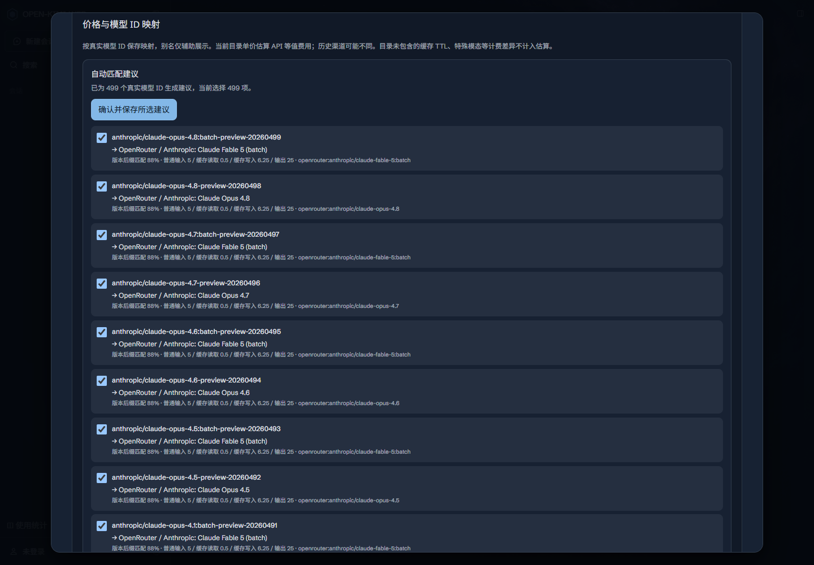
      </a>
    </td>
    <td align="center" valign="top">
      <a href="docs/images/feature-usage-pricing-mobile.png">
        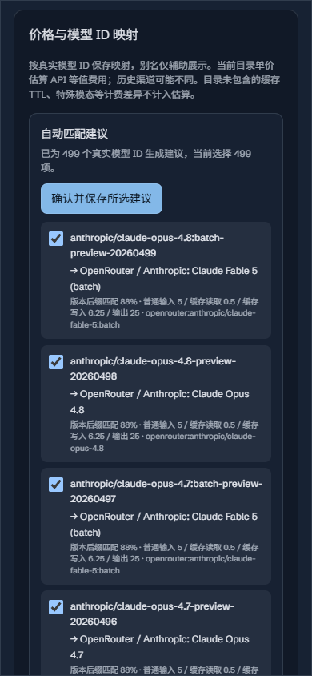
      </a>
    </td>
  </tr>
</table>

截图使用虚构演示记录，不代表真实账号、消费或提供的模型服务。

统计需要通过本项目接管的 `kimi web` 受管模式启动，以确认对应的本机 Kimi 数据目录。
独立 `serve --target` 会明确提示数据源不可用，避免把本机用量当作远端统计。
缓存数字以 Kimi 已记录的字段为准；供应商未上报、失败或中断且未落盘、删除或损坏的记录可能缺失。
缺少请求模型 ID 或关联不明确的旧记录保留 token 总量，单列为“模型 ID 未确认”，不猜测模型或价格。
模型 ID 不包含历史渠道信息；不明确的自动候选仍需批量确认。API 等值费用不是实际账单。

> 用量面板资源按序整体加载；若趋势图异常，分布与模型明细仍可查看。
> 价格刷新或保存成功后若面板重绘失败，会分别说明服务端结果与页面问题。

兼容边界见 [UPSTREAM.md](UPSTREAM.md)，逐版改动见 [CHANGELOG.md](CHANGELOG.md)。
此前性能验证见 [流式性能验收记录](docs/plans/streaming-performance-v1-verification.md)。

从旧版本升级后需要重启 `kimi web` / launcher，
再刷新或重新打开页面；已经运行的服务不会热加载新资源。

## 相对官方 Kimi Web 的完整增强功能

- **模型用量与 API 成本统计**：按时间、模型和工作区查看四类 token、缓存命中率、用量趋势和
  API 等值费用；历史回补、fork 去重、离线价格、自动匹配、批量确认和手动覆盖，详见上方主功能展示。
- **双端统一导航与会话搜索**：左上按“新建会话 → 新建工作空间 → 定时任务 → 搜索 → 使用统计”排列。
  手机和桌面共用官方搜索索引，支持内容／角色、匹配方式、排序与分页；结果打开所属会话，不声称定位到具体消息。
  双端新建工作空间直接输入运行端已有目录的绝对路径，支持粘贴带外层引号的路径，不切走当前会话或清空草稿。
  只注册已有目录、不创建文件夹或自动授信；路径属于 Kimi 运行端，而非手机／浏览器设备。
- **局域网 HTTPS**：让官方 server 保持回环监听，由 launcher 提供局域网 HTTPS、
  自签名证书和 SHA-256 指纹；Hyper-V／vEthernet 地址也进入访问链接与证书 SAN，不改系统网卡配置。
- **流式 gzip（r9）**：协商压缩较大的可压缩 HTTP 响应、官方／自定义静态和注入资源，使用 Node 内置流，
  无额外依赖、不缓存会话内容；保留正文、分页、鉴权、WS 与原有缓存策略，不重复压缩已编码响应。
- **token 直达链接**：在启动输出中提供带 `#token=...` 的 Local 与 Network 链接，
  页面挂载前移除 fragment。
- **可逆命令接管**：`integrate install` 可接管 `kimi web`，其它 `kimi` 命令原样透传；
  `status`、`repair` 和 `uninstall` 用于检查、修复和撤销接管。
- **安全安装自更新（r8 起）**：`update --check` 只检查实际执行安装，`update` 更新同一源码／npm 安装；
  源码只允许干净 main 快进，npm 使用 GitHub 最新正式 Release 的精确 tgz，不改官方 Kimi、接管或用户数据。
  不自动重启、回滚或切分支，不支持模糊安装；旧 r7 须先手动升级，详见[升级](#升级)。
- **稳定启动与诊断**：受管模式固定后端和入口端口，等待官方服务就绪，并清楚报告端口、
  工作区、后端、依赖和官方 bundle 错误。
- **移动页面适配**：改善首页、会话设置、模型菜单、工作区列表、输入区和 composer dock
  在小屏设备上的布局；提问卡片支持拖动调高并记住档位，超高题干与选项共同滚动，
  并修复桌面侧栏收起后的空白。
- **桌面聊天自适应宽度**：正文列和输入卡片随主聊天窗格宽度调整，
  大窗格正文可用列约占 60%，窄窗格保留必要边距；不按整个屏幕计算，手机与 Side Chat 保持原布局。
- **当前会话体积**：手机标题下、桌面主会话标题旁及空会话顶部显示当前会话日志的 B / KB / MB 体积，
  包含子代理、不含图片附件；每 10 秒轻量刷新，切换会话时不会沿用旧值。
  手机与桌面共用请求状态及刷新计时器；仅受管本机模式可计量，不可用显示“会话 —”。
  这不是模型上下文 token 占用，不读取日志全文。
- **消息时间戳**：主会话中，正式 transcript 提供可靠时间并能精确对应消息时，
  补显示缺失时间，支持点击或键盘展开完整日期；不伪造未知历史时间。
  Side Chat、仅从实时 WS 到达的消息，以及超过 1,048,576 字符的 transcript 响应保留官方时间显示，
  不为增强另行读取或解析大正文。
- **手机任务强提醒**：任务完成、审批请求和提问请求会显示可关闭的弹窗；待处理弹窗可定位
  到原控件，并避免初始空闲、切换会话、历史回放和断线重连误触发；Side Chat 输出不会推迟提醒。
- **五套氛围主题**：提供夜幕、极光、暮色、余烬和矿物青绿主题，覆盖桌面与手机；
  可恢复官方外观，选择只保存在当前浏览器和站点。
- **供应商编辑增强**：供应商标签支持触摸、拖动、滚轮和键盘导航；模型可配置多模态、
  工具、思考能力与思考档位，可从 `/models` 发现并添加模型，也可用鼠标或触摸排序。
  r2 新模型仅 `video_in`（视频输入）、`image_out`（图片输出）默认不选；
  `image_in`、`tool_use`、`thinking`、`always_thinking` 默认选中，六档 `none/low/medium/high/xhigh/max`
  及 `adaptive_thinking` 也默认选中。已有显式数组（含空数组）、未知值及 false 不自动改写，保存仍按独立字段合并。
  默认是用户偏好，不保证服务支持；保留 r1 发现选择、唯一可见表单与逐行身份匹配。准确要求与验收见 [r2 计划][r2-plan]。
  Kimi Coding 手动接入选 `Kimi` 协议，国内 Base URL 为 `https://api.kimi.com/coding/v1`，
  Global 为 `https://api.kimi.ai/coding/v1`；不能与开放平台 Key／地址混用。
  已授权实测 low 成功、xhigh 400；修后 thinking:on 未显式 effort 成功，medium/high/max 未逐档验证。
  如遇不支持的档位，须自行在供应商及会话明确调整；升级不自动清洗配置，历史证据见[热修复记录][provider-hotfix-plan]。
- **工作区最近活动排序与置顶**：桌面首次使用默认按最近活动排列，也可切回官方手动顺序；
  置顶项始终在前，多个置顶项按操作顺序排列。本地仅为置顶保存工作区 ID。
  手机会话抽屉支持原生“平铺／按工作区”，分别记住各端的视图选择。
  分组时可选“最近会话／工作区名称／桌面保存顺序”；平铺及组内会话仍按官方更新时间排列。
  身份能够唯一确认时沿用置顶；缺数据或缩写路径冲突时禁用桌面保存顺序，不猜 ID。
  排序只改变视觉顺序，不搬动 Vue 节点，因此键盘／读屏的 DOM 阅读顺序仍为官方顺序。
- **fork 标题保护**：官方 Web 在回合结束后自动生成标题时，若当前会话仍显示 `Fork: ` 前缀，
  保留该标题；手动重命名与主动重新生成标题继续使用官方接口。
- **归档会话删除**：已归档设置页和首页“已完成”列表提供永久删除；仅为唯一匹配项显示入口，
  二次确认后调用 Kimi Code 官方正式删除接口。
- **图片完整预览**：官方 `2.3.1` 的 PNG／JPG／GIF／WEBP／BMP／ICO／AVIF 与 PDF 已使用鉴权 download／Blob 预览。
  SVG 与旧版仍可能走 `fs:read`；保留增强 fallback，将截断 base64 图片转为官方鉴权 `fs/{path}:download`。
  fallback 校验图片 MIME、原 size 与实际字节，上限 32 MiB；此上限不是新版全部原生预览的限制。
  失败、超限或字节不全明确报错，不把半图当成功；部分读取、文本和无关请求不变，不持久化图片、路径与 token。
- **tab 及时反馈**：切换会话、分类和右侧文件 tab 时显示不挡操作的 Loading 与滚圈；关联响应交付
  让出一次绘制机会，原生 loading 出现后交回。快速点击只保留当前反馈，慢 B→快 C、错误和关闭均会清理。
  不改官方 bundle、不用 Vue 私有状态、不复制官方会话／文件状态，内容竞态仍由官方 generation 处理。
- **发送与阅读体验**：会话运行中可在桌面和手机使用“插队”按钮；按钮通过官方 `.send`
  创建当前 queued prompt，再按精确 `prompt_id` 调用 `prompts:steer`。官方快捷键仍由上游处理。
  工具调用完成后默认保持展开，已有手动偏好继续生效。实际选用的官方 UI ≥ `2.3.0` 时保留原生 Side Chat 滚动，
  不再注入旧 scrollTop guard；旧 `2.1.1`／`2.2.0` 仍保留向上阅读不抢位、回到底部恢复跟随的补丁。
- **流式更新开销控制**：增强层只处理相关区域变化，减少长历史扫描、无关响应解析与侧聊布局读取。
- **通知权限整流**：保留官方首次自动申请行为，合并并发请求；关闭提示后后台事件不会反复
  申请，设置中的主动重试仍可用。
- **官方界面轻量注入**：继续使用官方会话、模型和设置，将标签页及共用标题改为
  `open Kimi-Code web`；`--web-dir` 提供用户构建时不注入这些增强。

**定时任务轻量接入（版本受限）：** 双端“定时任务”入口可分页查看原会话中的任务、内容、计划、
模型来源及真实保存的触发记录；沿用原版后端与原数据目录，不加引擎、不改任务日志。
受管入口显式运行 `kimi web --scheduled-tasks` 才启用，默认关闭；未知后端版本（含未列出的相邻版本）拒绝。
精确 `2.1.1`／`2.2.0` 保留显式恢复确认后的新建、删除；精确 `2.3.1`／`2.4.1` 仅只读任务／历史。
`2.4.1` 的 cron／debug 核心与 `2.3.1` 相同，不据此放开写能力；WRITE 仍只允许上述两个旧版。
历史实测 `2.3.1` debug 写入可绕过会话锁和 stale gate，且可能延迟落盘，缺少兼顾归属、新鲜度与持久化回执的原子入口。
服务端 transport／route 双 gate 在 debug mutation 前拒绝只读版本写入；UI 中英提示只读、隐藏恢复／新建、禁用删除。
历史 `2.3.1` 定向测试及真实 launcher 验收确认创建／删除 409 且无 mutation，冷会话与 wire 不变；
本轮精确 `2.4.1` 的结果见 [2.4.1 适配计划][compat241-plan]，不把旧结果充作新版通过。
用户仍可主动打开原会话；历史 UI、CI 与发布记录保留于 [r1 适配计划][current-plan]。
不能与同实例官方 Remote Control 同用，外部 `serve --target` 不开放该能力；浏览器不能访问普通或编码的通用 debug 路径。
只读列表不恢复冷会话；旧版“恢复并管理”须确认会重新启动原任务，关闭网页不等于停止后台任务。
冷读需要有界扫描相应日志，缺失、损坏、变化或超限显示不完整，不能当成无任务；历史只显示最近最多 100 项、不支持翻页。
模型跟随所属会话，有证据才显示历史实际请求模型；原生没有的独立 cron 模型、编辑、暂停不伪造，回合完成不等于业务成功。
Tower 每任务模型不是 cron 独立模型。历史双版本公开链路不代表完整 2.2.0 UI、实体手机或其它平台已全面验收。
历史 r10 不含本功能；此前实现见[实施计划](docs/plans/scheduled-tasks-management-v1-plan.md)，不承诺新版 cron 全功能。

**r9 大会话传输与剩余边界：** 新增流式 gzip，不缓存会话内容、不收集完整正文后压缩。
HTTP 代理、官方／自定义静态与注入资源均可协商压缩；`--web-dir` 仍不注入展示层。
准确官方 `2.1.1` 原本只取最近 10 turn、以 `before_turn` 加载旧页，并保留最多 4 个 resident 会话，
因此问题不是全历史下载。后端先完整 reduce 再分页，每页带 tasks 等实体，单 turn 仍可能很大。
官方 Remote Control 会协商 gzip，本地入口及 r8 代理 raw 传输；本轮只修已确认的可压缩传输差异。
完整官方 app 的 r9 源码实测通过：10 个样本／217 项断言及 27 项边界断言，无页面错误。
25 ms＋1 MiB/s、桌面 Original、显式工具折叠，n=3 中位数：工具／正文／entity 可见时间由 r8 的
2885／2761／4546 ms 降至 109／257／145 ms。使用虚构高度重复 fixture，不代表普遍压缩倍数或真实 tunnel／LAN。
输入验证在正文可见后执行，不是输入框最早可用时刻；旧页、resident 切换、响应竞态及合法 WS 恢复通过。
工具展开的共同 render／layout 仍有 400–900 ms 长任务；不改默认展开、显式偏好、observer 或主题。
代表实图已核对；Original 手机顶部 badge／subtitle 的既有对比问题不变，不宣称全面视觉通过。
压缩不能消除后端恢复、JSON 解析与同步渲染；实体手机、真实家庭 Wi-Fi 和生产安装未验证。

**r9 Windows 标准检查：** lint、typecheck、66 文件／1146 项 UT、13 文件／154 项 IT 与 test:pack 通过。
UT 行／分支覆盖率 88.14%／80.76%，IT 87.98%／75.91%；覆盖率门槛不变。
补齐条件请求变体 metadata、既有响应头、205 长度及首 gzip 段后的空闲超时回归。
打包冒烟确认 r9 版本、压缩模块随包及静态／API 实际调用；源码 app 实测不等于交付包浏览器验收。
交付包浏览器、CI 与线上验证按发布流程单独记录在[计划](docs/plans/large-session-lan-performance-v1-plan.md)。

**保留的 r8 历史验收（非 r9 结果）：** Windows lint、typecheck、65 文件／1007 项 UT、
11 文件／89 项 IT 与 test:pack 通过。
Windows UT 行／分支覆盖率 87.58%／79.64%，IT 87.43%／74.87%；覆盖率门槛不变。
[PR #24 Ubuntu CI](https://github.com/WilliamLambertCN/open-kimi-web/actions/runs/37879364663) 通过 lint、typecheck 与 test:pack。
Ubuntu UT 65 文件、1006 项通过＋1 项 Windows-only 跳过（共 1007）；IT 10 文件通过＋1 文件跳过，
87 项通过＋2 项 Windows-only 跳过（共 89）。Ubuntu UT 行／分支覆盖率 87.31%／79.79%，IT 86.11%／73.95%。
官方完整 app 使用虚构数据完成 42 组手机外观矩阵及分页、折叠、选择、偏好和断点定向补验。
自更新已完成隔离源码／npm 安装与测试 tgz 的真实替换，Ubuntu CI 另验证 npm Config／Pacote 反证和
POSIX TERM／process-group 收尾；未更新用户实际安装。线上资产安装与已最新检查在发布后单独核验。
实体手机与用户实际数据未验证，不公开用户截图。

**保留的 r6 图片与 tab 验收：** 实际 r6 tgz 的等价图片 Chrome 像素矩阵完成 115 项断言、110 张截图：
opaque 2.69 MB、transparent 1.57 MB、>10 MiB、失败及 Fit／Actual 的全部主题检查通过，完整 RGBA 正确。
此矩阵不同于完整 app 验收：另以官方 `2.1.1` 完整 app 动态 import 实际解包的 officialPresentation 资源，
4 张 PNG 的原生 `.fp-image` 完成 read 1 MiB→download；opaque 3,148,932 bytes、透明 1,833,306 bytes，
底部 RGBA 及原生 Fit→Actual→Fit 正确。原始桌面、夜幕手机两组 8 次点击绘制机会为 9.8–34.5 ms，
慢 B→快 C、失败及关闭通过。此前 14 组／56 次点击的 4.6–31.1 ms 与清理验证仍保留。
这些指标是绘制机会，不是系统显示延迟。约 2.1 MB 内联文本仍需 453.6 ms，45 turn 缓存会话仍需 152 ms，
两者仍阻塞主线程；安全外层没有拆分官方同步渲染的公开 hook，不能宣称所有 tab 卡顿都已修复。
r6 当时的 lint、typecheck、644 项 UT、61 项 IT、test:pack 和实际包安装启动通过，PR #22 CI 已绿。

## 界面预览

以下主题与交互截图基于官方 `0.41.0` 前端，当前兼容目标 `2.4.1` 的组件细节可能不同；图片保留为历史展示。
截图使用隔离浏览器和固定演示数据；`demo-project`、对话内容与 `Demo` 模型均为虚构示例。

**主推：夜幕 · Nocturne — 工作区、会话与对话界面**

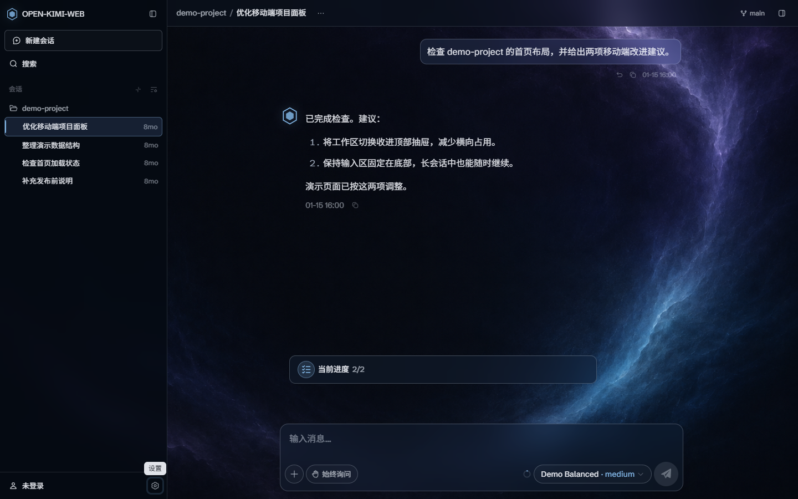

**手机端：主推夜幕对话、极光主题切换与余烬模型菜单**

<p>
  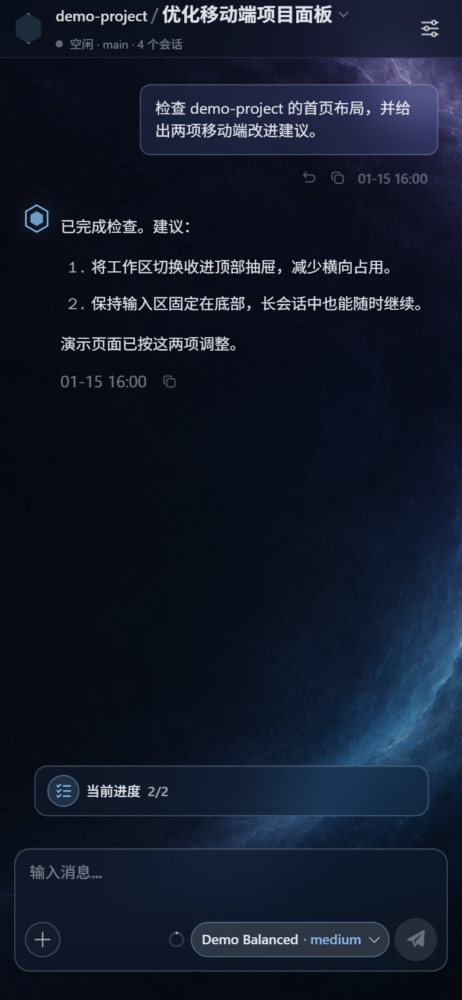
  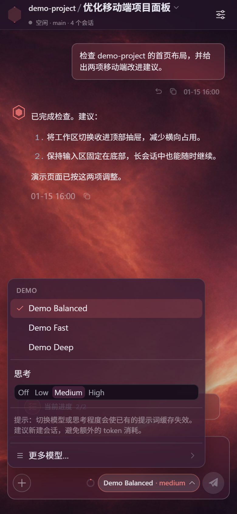
  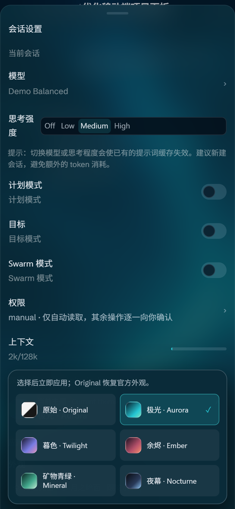
</p>

### 交互功能预览

供应商标签超出弹窗宽度时，可直接触摸滑动或按住鼠标拖动；鼠标滚轮和键盘方向键也可横向浏览。

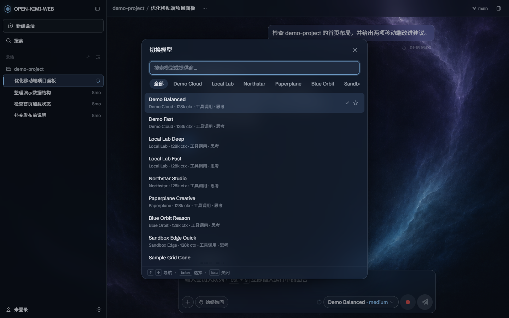

会话运行中输入新内容后，桌面端和手机端可点“插队”发送当前草稿。按钮会先复用官方 `.send`
创建 queued prompt，再按返回的 `prompt_id` 精确 steer；官方 `Ctrl+S` 的行为由上游自身处理。

<p>
  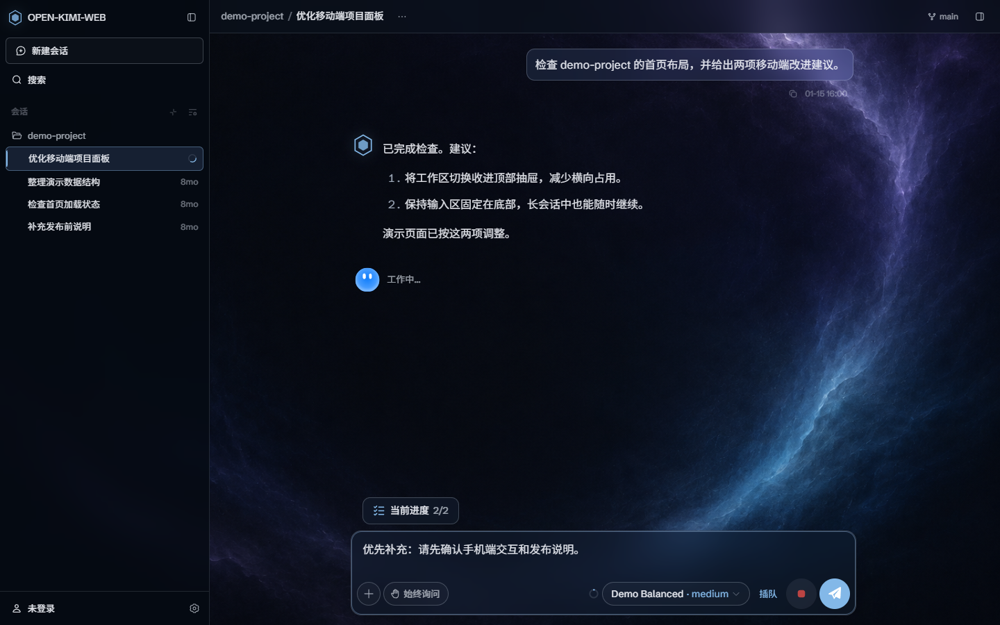
  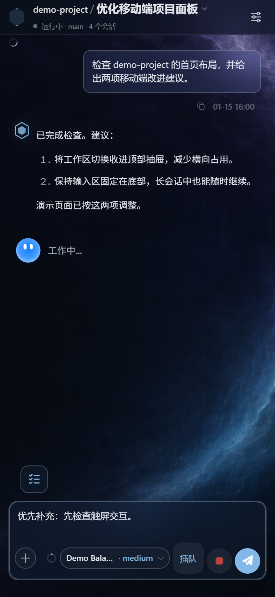
</p>

**五套主题预览**（夜幕为主推视觉）：

- **夜幕 · Nocturne（主推）**：[桌面](docs/images/theme-nocturne-desktop.png) ·
  [手机](docs/images/theme-nocturne-mobile.png)
- **极光 · Aurora**：[桌面](docs/images/theme-aurora-desktop.png) ·
  [手机](docs/images/theme-aurora-mobile.png)
- **暮色 · Twilight**：[桌面](docs/images/theme-twilight-desktop.png) ·
  [手机](docs/images/theme-twilight-mobile.png)
- **余烬 · Ember**：[桌面](docs/images/theme-ember-desktop.png) ·
  [手机](docs/images/theme-ember-mobile.png)
- **矿物青绿 · Mineral**：[桌面](docs/images/theme-mineral-desktop.png) ·
  [手机](docs/images/theme-mineral-mobile.png)

### 切换主题

桌面端打开左下角账号菜单，选择**氛围主题**；手机端打开**设置 → 氛围主题**。选择后立即生效：

| 主题 | 配色与背景 |
| --- | --- |
| **Nocturne · 夜幕（主推）** | 更深的墨蓝、克制的蓝紫边缘光，作为仓库主推展示风格 |
| Aurora · 极光 | 海蓝底色、青色极光与柔和光晕 |
| Twilight · 暮色 | 靛蓝底色、薰衣草紫与灰粉色暮光 |
| Ember · 余烬 | 深梅紫底色、珊瑚与蜜桃色暖光 |
| Mineral · 矿物青绿 | 深石油绿、鼠尾草与薄荷绿层次 |

初次使用默认夜幕。主题选择（包括原始外观）保存在当前浏览器、当前站点的 `localStorage` 中，
刷新后保持；已有选择不会被默认值覆盖，不同设备需要各自选择。选择原始外观会移除主题覆盖，
恢复官方浅色、深色或跟随系统设置。浏览器禁止本地存储时仍可切换，但无法保证刷新后保留。

这些主题分别使用随 launcher 附带的星云纹理，配合半透明面板、细描边、六边形标记与紧凑的手机布局。只加载当前主题的背景，无需访问外部图片服务。素材来源与生成提示见 [主题素材说明](docs/THEME-ASSETS.md)。

## 手机子代理模型与英文界面（r10）

手机端子代理默认模型和思考强度沿用主模型选择器风格：底部面板、搜索、供应商标签、两行模型列表、勾选与分段思考。
同供应商同名长 alias 前置真实唯一差异，完整身份按需展开并保存完整 alias；保留桌面原入口和官方外观。
官方 `2.1.1` 未导出 ModelPicker 或完整 Settings 的手机打开动作；独立控件复用语义结构、必要样式和 token，
不调用 Vue 私有实例或主模型选择动作。读取官方 config／models，仅 POST `/api/v1/config` 的 `secondary_model` 并合并模型池，
不覆盖主模型、权限或其它配置，不另存 localStorage。
Auto 可提交 `defaultEffort: ''`，按全局思考设置／模型默认；已配置模型仍不能通过官方 API 清除为跟随主模型，
空模型／null 无效，merge 省略字段不清除。

增强层以官方 `kimi-locale` 为准，修复本轮覆盖的主题、手机状态、会话、usage／provider 等英文系统文案，
包括 text／title／aria／placeholder；用户填写的中文模型／供应商名仍保留。同 tab 切换刷新已挂载文案，保留草稿和输入，不新增请求。
实体手机、软键盘与真实磁盘持久化未验收；历史本地检查和原 strict scrollTop 失败见
[手机计划](docs/plans/mobile-subagent-model-v1-plan.md)。发布与资产核对见[发布计划][r10-plan]，沿用已有阶段结果。

## 快速上手

### 一键兼容式安装与选项

普通用户使用 README 顶部的完整在线命令，不必克隆仓库或安装开发依赖；本项目不发布到 npm registry。
命令从 `v2.4.1-r1` commit API 解析并校验真实 40 位 SHA，下载同 SHA 入口，传同一 `--revision` 获取完整安装器。
固定 `--version 2.4.1-r1`；tag、入口或资产不可用即停，不回退旧版、不直接执行可变名称入口；HTTPS 不等于签名验证。
从同一提交的完整源码目录运行时，本地入口默认使用相邻协调器；不要混用不同提交的入口与 helpers：

```powershell
powershell -NoProfile -ExecutionPolicy Bypass -File .\scripts\install.ps1 --version 2.4.1-r1
# 仅装包，不建立、修改或撤销接管
powershell -NoProfile -ExecutionPolicy Bypass -File .\scripts\install.ps1 --version 2.4.1-r1 --no-integrate
# 本地帮助不联网、不写安装目录，也不要求 Node
powershell -NoProfile -ExecutionPolicy Bypass -File .\scripts\install.ps1 --help
```

```sh
sh scripts/install.sh --version 2.4.1-r1
sh scripts/install.sh --version 2.4.1-r1 --no-integrate
sh scripts/install.sh --help
```

- **运行时隔离**：优先选 Node ≥ 22.19.0 与配套 npm，缺合适版本才下载固定 Node `22.23.3`，校验 SHA-256。
  存于 `${OPEN_KIMI_WEB_HOME:-~/.open-kimi-web}/runtime/node-v22.23.3-<平台>`；自定义 home 须是安全的绝对目录。
  launcher 专用 `npm` prefix、官方 `official` prefix、runtime 与 wrapper `bin` 分开，不覆盖系统 Node 或默认全局包。
- **先发现并复用官方 Kimi**：保留显式 override／已登记接管目标／实际 PATH 的优先关系，
  有界检查官方默认 bin、`KIMI_INSTALL_DIR/bin`、uv／XDG／默认 local bin、Windows 持久 Machine／User PATH、
  APPDATA/npm 及所选 Node 旁标准命令；不递归扫盘、不修改持久 PATH 来搜索。
  无明确优先关系的多份安装须显式 override；未知 PowerShell 函数／脚本／带参 wrapper 不执行，不猜版本新旧。
  明确输出复用哪份官方 CLI，**不下载或升级该 CLI**；仍可能需要下载 launcher Release 或 Node runtime。
  损坏、歧义、不支持、坏 override／partial／未知归属明确拒绝，不能变成 missing 后另装或自动续装。
  只有确认缺失才准备固定真实官方 `2.4.1` tarball／SHA-512；ignore-scripts 避免 postinstall 迁移旧 Python 命令。
  旧 owned `2.3.1`／`2.1.1` 按精确 version／integrity、package 身份及 entry／shim digests 验证后复用，不自动升级。
- **按版本检查 shell runtime**：官方 `2.4.1` 无 node-pty，按精确身份做真实 Node `child_process` shell probe，
  不是任意缺 node-pty 都算成功。旧 owned `2.3.1`／`2.1.1` 仍须真实 PTY；正确 probe 成功才写 record。
  owned 重复安装再 probe，损坏拒绝，不自动 rebuild 已有安装；non-owned native／npm 安装不重建。
  Linux 仅 legacy rebuild 需要 Python 3、C／C++ 编译器和 make，**新版不再无条件要求该编译工具链**。
  legacy rebuild 只审计固定 node-pty 1.1.0／node-addon-api 7.1.1，并限定绝对 node-pty 目录，
  不跑根 Kimi 迁移或其它包脚本；保留 noexcept.gypi 审计与 MAKE 前缀／FLAGS 过滤，不 sudo／apt 或自动装工具链。
- **Windows Git Bash**：仍是官方必需项。验证并复用已有 Git Bash（含 `KIMI_SHELL_PATH`）；
  缺失才严格校验 portable asset 的 size／SHA-256，在用户目录解包，不改系统 Git。
  保留 exe module／7z payload，仅替换 SFX RunProgram 为 true.exe；不运行默认 git-bash.exe／post-install.bat，
  随后显式执行审计过的白名单初始化。
- **接管和升级**：默认接管；已有其它已识别源码／prefix 需显式 `--switch-installation`，未知／部分接管及降级仍拒绝。
  不删除旧安装；`--no-integrate` 不建立、修改或撤销接管。已有用户日常升级用下方 `update`，不重跑安装器。
  `--version` 固定 launcher Release，不改变缺官方时固定的 `2.4.1`；`--revision` 仅薄入口处理同 SHA 的完整源码归档。
- **外部前提和权限**：仍需联网及 PATH 中标准 curl／tar，**不是离线安装**，不需要管理员权限。
  不自动登录、读取真实会话、发付费调用或启动生产服务；shell 不支持接管或 PATH 被遮挡时按输出处理，不假报接管成功。

**验证边界：** 本轮真实入口、精确官方 runtime、复用与拒绝场景以 [2.4.1 适配计划][compat241-plan]记录为准。
旧 Windows x64／Linux 标准工具环境场景用 r9 包，Windows 接管用注册表 seams；portable 与缺 Git 完整 coordinator 分开验证。
旧 WSL 缺 make／C++ 的 PTY 失败保留为 legacy 历史，不据此断言新版 2.4.1 仍需编译工具；Web 200 不能代替适当 shell probe。
macOS／arm64、Windows 真注册表／新终端及实体手机未全面验收，不承诺所有平台。根安装器不在 launcher tgz。
历史 fixture／失败见[安装计划](docs/plans/one-click-install-v1-plan.md)及 [r10][r10-plan]／[r1][current-plan]／[r2][r2-plan]计划。

### 手动 npm 安装（已有 Node ≥ 22／npm 的用户）

此路线只安装 launcher，需自行准备可运行的官方 Kimi；官方 npm `2.4.1` 需 Node ≥ 22.19.0，Windows 还需 Git Bash。
不需要 Corepack／pnpm。正式发布后，首次安装且尚未接管时可用固定 tgz URL：

```sh
npm install -g https://github.com/WilliamLambertCN/open-kimi-web/releases/download/v2.4.1-r1/open-kimi-web-2.4.1-r1.tgz
open-kimi-web integrate install
```

### 开发者源码安装

仅开发／维护源码时才需要 Node ≥ 22、Git 和 Corepack／pnpm；普通用户无需走此路线。

```sh
git clone --branch main https://github.com/WilliamLambertCN/open-kimi-web.git
cd open-kimi-web
corepack pnpm install --frozen-lockfile

# 一次性接管 kimi web
node packages/launcher/bin/open-kimi-web.mjs integrate install
```

已经接管过 `kimi web` 且手动切换安装方式或目录时，还需按[升级](#升级)中的说明更新接管入口。
源码接管会引用此仓库中的 launcher，安装后请保留仓库目录。
下面的 Corepack 网络排查仅适用于源码路线，不是使用一键安装器的前提。

如果 Windows 在 `corepack pnpm install` 下载 `pnpm-10.33.0.tgz` 时出现
`ECONNRESET`，先解决 Corepack 的下载链路，再运行 `integrate install`；直接跳过依赖安装
只会得到不能启动 Web 服务的 launcher。Corepack 下载 pnpm 本体时使用自己的 registry，
不会读取尚未启动的 pnpm 配置。可先重试；需要使用仓库已有的 npmmirror 回退时，
在当前 PowerShell 中同时设置 Corepack 和 pnpm 的 registry，然后按锁文件重新安装：

```powershell
$env:COREPACK_NPM_REGISTRY = 'https://registry.npmmirror.com'
$env:npm_config_registry = $env:COREPACK_NPM_REGISTRY
corepack pnpm install --frozen-lockfile
```

如果网络必须经过代理，请设置真实可用的代理地址；新版 Corepack 通过 Node 的环境代理开关
读取 `HTTPS_PROXY`：

```powershell
$env:NODE_USE_ENV_PROXY = '1'
$env:HTTPS_PROXY = 'http://127.0.0.1:<port>'
corepack pnpm install --frozen-lockfile
```

不要原样复制占位地址，也不要通过关闭完整性校验绕过下载问题。变量说明与网络排查项见
[Corepack 官方文档](https://github.com/nodejs/corepack/blob/main/README.md#environment-variables)。安装成功后再执行上面的
`integrate install`。

### 首次启动（确认接管后）

安装器不自动启动服务。默认安装或手动接管完成、输出确认接管生效后，**开一个新终端**：

```sh
open-kimi-web integrate status
kimi web --host
```

先核对状态输出和 PATH／wrapper 目标，再启动；无接管时 status 也可能退出 0，旧 shell 可能仅显示 note。
r9 status 按首个已有 rc 文件诊断，多 rc 的 zsh 场景可能错误警告；安装器另行验证实际 shell 的 rc 与 wrapper，
应结合新终端的实际命令判断，不因该警告盲目 repair 或切换安装。
bash 接管预检在 Release／npm 前检查 `.bash_profile`，仅它缺失时检查 `.bash_login`，不修改该 profile。
只接受空行／整行注释加无条件 `source ~/.bashrc`、`. ~/.bashrc` 或加载 `"$HOME/.bashrc"`／`"${HOME}/.bashrc"` 的行；
空文件、仅注释、条件或未知复杂脚本明确拒绝，不宣称接管成功。可选 `--no-integrate`，或手动安排简单加载后重试。
原生 WSL 的已知简单加载 profile 已通过 bash `--login -ic` 补验，无新增下载。
使用 `--no-integrate` 仅安装包时，本节接管启动流程不适用；需要之后明确授权接管或自行启动独立代理。

终端会打印：

```text
  Local:   https://127.0.0.1:48627#token=...
  Network: https://192.168.x.x:48627#token=...   ← 手机连这个
  SHA-256 fingerprint: 9D:0A:F1:...              ← 首次访问先核对它
```

手机连同一局域网，打开 Network 链接，浏览器提示证书不受信时**核对指纹一致**再接受。搞定。

接管模式保留官方 Kimi 后端的固定回环端口 `58627`，Open Kimi Web 使用配套的固定对外端口
`48627`。如果端口已被其他程序占用，启动会明确失败；可关闭占用程序，或显式使用
`kimi web --port <port>` 更换 Open Kimi Web 的对外端口。

接管后 `open-kimi-web` 命令本体也在 PATH 上：

```sh
open-kimi-web integrate status      # 健康检查
open-kimi-web integrate repair      # 官方 kimi 升级后修一下
open-kimi-web integrate uninstall   # 撤销接管，恢复官方命令路径
```

`integrate uninstall` 只撤销 wrapper／PATH 接管，不卸载专用 npm prefix 或私有 Node runtime。
Windows 一键安装器加入的私有 Node User PATH 项在 r9 撤销后仍保留；无需时按安装输出的路径手动移除。
不要把它当作删除旧源码、其它安装或官方 Kimi 的清理命令。

### 升级

**安全自更新（r8 起可用）：** 提供 `open-kimi-web update --check` 和 `open-kimi-web update`。
旧 `r7` 发布包没有该命令，须先用下方手动方式升级至 r8 或更高版本。

```sh
open-kimi-web update --check   # 只检查当前执行安装和更新目标，不写入
open-kimi-web update           # 更新该安装，不更新官方 Kimi、不自动重启
open-kimi-web update --help
```

**2.3.1-r2 → 2.4.1-r1：** 新版本正式发布后，先运行 `update --check` 核对同一安装及目标 `2.4.1-r1`，
再运行 `update`。一键／npm 安装不必重跑安装器、同版本重装或追加 `--switch-installation`。
源码安装仍须使用跟踪 `origin/main` 的干净 main，只允许快进；不会自动切换当前 develop 或其它分支。
完成后自行停止旧 launcher 与对应受管后端，重新启动 `kimi web --host` 并刷新／重开页面；独立 target 须自行重启实际 backend。
已有显式模型配置不自动改写，r2 默认继续保留；更新 launcher **不会升级用户已有官方 Kimi**，官方版本仍以实际 backend 为准。
Tower 开关变更须遵守上方启动环境与后端重启说明，不自动开启。本轮发布、latest/update 与线上核验见 [2.4.1 计划][compat241-plan]。

**历史：2026-10-26 同版本 r1 热修复。** 当时 npm 更新器跳过相同版本，需要原 home／选项重跑安装器，
或把新下载的 r1 tgz 用原 npm 安装到原 prefix；这不是升级到新版本的要求。
准确历史步骤见 [CHANGELOG](CHANGELOG.md)及[热修复计划][provider-hotfix-plan]；[r2 更新与发布记录][r2-plan]也保留为历史。
不据此要求清空配置、会话或缓存，不移动旧 tag 或替换旧资产。

一键安装的专用 prefix 是标准 npm 全局布局，常规新版本仍用 `update` 更新同一安装，不需要重跑安装器或追加切换参数。
已接管 wrapper 使用记录的 Node，更新器优先解析该 Node 旁的 npm；不需要先给系统安装 Node 或 Corepack／pnpm。
使用 `--no-integrate` 后没有新 wrapper／PATH 入口，不能假定 `open-kimi-web` 命令已经可用：
用安装时选定 Node 的**绝对路径**执行专用 prefix 中的 launcher 入口，再加 `update --check`／`update`。
安装结束会打印绝对路径的 `Update:` 命令；先加 `--check` 核对目标，PowerShell 中须保留命令开头的 `&`。
默认 Windows 入口是 `~/.open-kimi-web/npm/node_modules/open-kimi-web/bin/open-kimi-web.mjs`，
POSIX 是 `~/.open-kimi-web/npm/lib/node_modules/open-kimi-web/bin/open-kimi-web.mjs`；
采用自定义 home 时以实际目录为准，不要用 `npm root -g` 猜这个专用 prefix，也不要把裸 `node` 当成私有运行时。
仅安装包未撤销旧接管时，PATH 上的命令可能仍指向旧安装，必须先确认实际入口。

命令从自身入口识别安装，不依据当前目录或默认 npm prefix 猜测。源码仅接受官方仓库中干净、
跟踪 `origin/main` 的 `main`，快进后按 frozen lockfile 安装依赖；有修改、领先、分叉或开发分支时拒绝，
不会 stash、reset 或切分支。npm 全局安装更新到 GitHub 最新正式 Release 的固定 tgz，支持自定义 prefix；
简单 npm 本地直接依赖会保留生产／开发依赖类别，同时更新所属项目的 package.json 和 package-lock.json。
不支持临时 npx、任意解压目录、链接、workspace、混合包管理器或无法确认身份的安装，也不会改另一份全局包。

检查／成功退出 0，安全拒绝、网络、安装或验证失败退出 1，参数错误退出 2。
更新不是原子操作；源码已快进但安装失败、或 npm 部分完成时会说明失败阶段及恢复方式，不自动回滚。
接管入口位置不变时无需 repair；更新不会修改 PATH、接管状态、证书、官方 Web 缓存或会话数据。
包管理器自己的下载缓存可能正常变化；npm 本地更新仍会解析所属项目的依赖树，不承诺无关依赖逐字节不变。
若工具后代的退出无法确认，会保留安装锁并拒绝再次更新；先核实原 updater 及其后代已停止，再按错误提示解除锁。
仍需自行停止旧 launcher 后重启，再刷新页面；切换安装位置则继续按下方说明 repair。

**已有全局 tgz 安装：** 优先使用 `update`；手动升级时，再次运行上面的版本化 `npm install -g`。

**已有 main 源码安装：** 在原仓库的 main 分支执行：

```sh
git pull --ff-only origin main
corepack pnpm install --frozen-lockfile
```

**切换到源码安装：** 先按上面的源码流程克隆 main 并安装依赖，
然后在新仓库目录执行以下命令，让接管入口使用这份源码：

```sh
node packages/launcher/bin/open-kimi-web.mjs integrate repair
```

**从源码切换到全局 tgz 安装：** 安装发布包后，显式使用全局包入口更新接管，避免命令仍指向旧源码：

```sh
node "$(npm root -g)/open-kimi-web/bin/open-kimi-web.mjs" integrate repair
```

单独执行 `integrate install` 在已有完整接管时可能不做修改，因此切换安装位置需要显式 `repair`。
随后开一个新终端检查接管状态：

```sh
open-kimi-web integrate status
```

结合目标与新 shell 的实际命令确认 wrapper、PATH 或真实 `kimi` 异常后，才使用目标入口执行 `integrate repair`；
多 rc 的 zsh 仅有上述 r9 status 警告时，不盲目 repair。
最后停止原终端中运行的旧 `kimi web` / launcher，在新终端重新执行 `kimi web --host`，
再刷新或重新打开浏览器页面。拉取源码不会热替换运行中的服务与已加载的页面脚本，无需迁移会话数据。

不想接管也行——自己先跑 `kimi web`，再运行
`node packages/launcher/bin/open-kimi-web.mjs serve --lan`，即可使用代理、HTTPS 与页面增强。

## 工作原理

接管前：

```text
手机/浏览器 ──HTTP 明文──> kimi 官方 server（绑 0.0.0.0，局域网可见）
```

接管后，同一条 `kimi web --host` 命令：

```text
手机/浏览器 ──HTTPS──> OpenWeb launcher（绑 0.0.0.0，你看到的入口）
                           │  本机回环代理，不出机器
                           ▼
                      kimi 官方 server（只听 127.0.0.1:58627）
```

接管通过 PATH 中的小 shim（`~/.open-kimi-web/bin/kimi[.cmd]`）实现：支持的 `web` 参数走
上面的两段式启动，其余调用交给官方二进制。Windows 安装写入 User PATH；若 System PATH
中的官方 `kimi` 排在前面，需按安装警告调整顺序，并用 `integrate status` 检查。局域网
无法直接访问被托管的真实 server；HTTPS、token 链接和指纹由 launcher 负责。

## 官方界面与手机适配

launcher **默认服务官方 `kimi-code` npm 包里的 `dist-web` 构建产物**（MIT 许可），继续使用
官方的会话、模型与设置功能。标题补丁将浏览器标签页及共用标题模板的页面顶栏改为
"open Kimi-Code web"。手机端另加独立展示层，对齐首页、会话设置、模型菜单和工作区列表。

- **首次启动需联网**：launcher 会从 npm registry 下载对应版本的包（约 20 MB，仅一次），
  自动探测版本（问 target 的 `/api/v1/meta`，失败则回落到 `2.4.1`）；先试
  npmjs，再试 npmmirror 镜像，尊重 `HTTPS_PROXY`/`HTTP_PROXY`。
- **下载校验范围**：有 registry 的 sha512 integrity 元数据时校验下载包；元数据缺失时警告。
  仍会检查解包和必需文件是否完整；不会在每次启动时对缓存逐文件计算哈希。
- **缓存**：解包后缓存在 `~/.open-kimi-web/official-web/<版本>/`，之后离线可用；title 补丁只在缓存时打一次，
  `boot.js`（官方原样）与上游 `LICENSE` 一并落盘。
- **展示层与主题**：由 launcher 在官方页面响应中加载 `src/mobile/` 的独立样式与脚本；
  既有缓存也会生效，无需重下载或修改上游缓存。资源使用 `no-cache`；布局调整仅在手机
  宽度启用，主题支持桌面与手机，侧栏品牌文字统一显示为 `OPEN-KIMI-WEB`。供应商模型
  能力通过官方 `POST/PUT /api/v1/providers` 字段保存；模型发现请求由受当前页面 bearer
  token 保护的 launcher 同源端点转发，限制为 http(s)、短超时、1 MiB 响应且不跟随
  重定向，API Key 不写日志、不回显。`--web-dir` 不注入该展示层及主题功能。
  当前静态对照官方构建为 `2.4.1`；真实运行证据见 [本轮计划][compat241-plan]，实际 UI 版本控制兼容注入。
- **失败行为（兼容性变更）**：官方 bundle 不可用时 launcher 现在会明确中止启动，不再静默改用不同的界面。恢复 npm 网络与 `curl` / `tar` 后重试，或用 `--web-dir` 指向隔离且已准备好的官方前端构建目录。
- **显式指定**：`open-kimi-web serve --web-dir <path>` 直接公开并服务现成构建目录。
  不要在目录中放日志、备份、配置或凭证；静态服务会拒绝通过符号链接越过该目录。
  `--web-version <ver>` 固定官方包版本；接管后的 `kimi web` 也支持
  `OPEN_KIMI_WEB_DIR` / `OPEN_KIMI_WEB_VERSION`。

旧版内置前端已移除：请删除启动参数 `--web-ui open` 或环境变量 `OPEN_KIMI_WEB_UI=open`，
使用默认官方界面。`--web-version` 仍可固定官方版本；`--web-dir` 仅用于加载自行修复后的隔离前端构建目录。

## Kimi 插件入口

仓库根目录也是一个 Kimi Code 插件，可用 `/plugins install <此仓库>` 注册
`/open-kimi-web:install|status|repair|uninstall` 四个管理命令。**安装插件只会注册这些
skill/命令，不会安装 npm launcher、启动服务或修改 PATH。** 使用前仍需单独安装 launcher。

插件与 launcher 的接管状态彼此独立：移除插件不会运行 `integrate uninstall`，也不会撤销
外部写入的 wrapper/PATH；`integrate uninstall` 只撤销接管，不会卸载 launcher 或插件。

## 安全说明

- token 直达链接 = 完整编程代理权限，**别分享**。
- 官方 UI 的 token 存储行为由上游负责；带 token 的直达链接仍等同完整编程代理权限。
- 回环默认 HTTP；`--lan` / 非回环 `--host` 自动 HTTPS；`--insecure-http` 是显式降级（会打印警告）。
- 自签名证书存于 `~/.open-kimi-web/tls/`，启动时若临近过期或 SAN 缺失会自动轮换。
  监听所有网卡时，访问链接与证书包含启动时探测到的物理网卡和 Hyper-V／vEthernet 地址；IP 变化后需重启 launcher。
  回环、内部标记与 IPv6 link-local 地址仍排除；列出地址不代表防火墙和路由一定可达。
- 只代理 `/api/*`；`Authorization` 原样转发、绝不落日志；`index.html` no-cache，带 hash 的 `/assets/*` immutable。

## 开发

Node ≥ 22 + pnpm 10.33（`corepack pnpm …`，root 已锁版本）：

维护职责、官方版本边界、分支模型和验证规则见 [`AGENTS.md`](AGENTS.md)。

```sh
pnpm dev            # 直接启动 launcher，连接本机官方 Kimi 服务
pnpm dev -- --lan   # pnpm 透传参数；也可写作 pnpm dev --lan
pnpm lint           # ESLint + 复杂度硬门禁
pnpm typecheck      # TypeScript 检查
pnpm test:ut        # 单元测试（行/分支覆盖率 <70% 即失败）
pnpm test:it        # 集成测试（同上）
```

`pnpm dev` 只启动 launcher，要求官方后端已经监听在配置的 target。已经执行过
`integrate install` 时，直接用 `kimi web --host` 启动受管后端和增强层，不要再同时运行
`pnpm dev`。未接管时，先用真实的官方 Kimi 二进制启动 target；如果 `kimi` 已指向
wrapper，应调用它所记录的真实二进制，再运行 `pnpm dev`。

结构：`packages/launcher` 包含 HTTPS、REST/WS 代理、官方资源加载和手机展示层；
`contracts/upstream` 保留历史协议快照作为参考。上游版本与维护边界见 [`UPSTREAM.md`](UPSTREAM.md)。

当前兼容目标：CLI `2.4.1`（官方发布标签指向
[`2c73f3f5`](https://github.com/MoonshotAI/kimi-code/commit/2c73f3f50af4fa7f2540ca0d2e33b07a1408e3a7)）；
官方 npm engines 为 Node `>=22.19.0`。本轮源码／包检查、准确 backend／UI、门禁与发布记录见 [2.4.1 计划][compat241-plan]。
[r1 适配][current-plan]、[r2 默认与发布][r2-plan]等历史验收不代表新版完整通过；未读取用户现场，也未在实体手机上验证。

## License

MIT — 见 [`LICENSE`](LICENSE)。Moonshot AI 的 MIT 许可代码保留原始声明，详见
[`THIRD_PARTY_NOTICES.md`](THIRD_PARTY_NOTICES.md)。运行时下载的官方 web 前端缓存于
`~/.open-kimi-web/official-web/<版本>/`，旁边保留其 `LICENSE`。

[ci-badge]: https://github.com/WilliamLambertCN/open-kimi-web/actions/workflows/ci.yml/badge.svg
[ci-workflow]: https://github.com/WilliamLambertCN/open-kimi-web/actions/workflows/ci.yml
[r10-plan]: docs/plans/one-click-install-r10-release-v1-plan.md
[r10-release]: https://github.com/WilliamLambertCN/open-kimi-web/releases/tag/v2.1.1-r10
[current-plan]: docs/plans/kimi-code-2.3.1-workspace-release-v1-plan.md
[provider-hotfix-plan]: docs/plans/provider-model-discovery-r1-hotfix-v1-plan.md
[r2-plan]: docs/plans/provider-defaults-r2-release-v1-plan.md
[r2-release]: https://github.com/WilliamLambertCN/open-kimi-web/releases/tag/v2.3.1-r2
[compat241-plan]: docs/plans/kimi-code-2.4.1-compatibility-v1-plan.md
[current-release]: https://github.com/WilliamLambertCN/open-kimi-web/releases/tag/v2.4.1-r1
[official-231-release]: https://github.com/MoonshotAI/kimi-code/releases/tag/%40moonshot-ai/kimi-code%402.3.1
[official-changelog]: https://www.kimi.com/code/docs/en/kimi-code-cli/release-notes/changelog.html
[official-tower]: https://www.kimi.com/code/docs/en/kimi-code-cli/guides/tower.html
